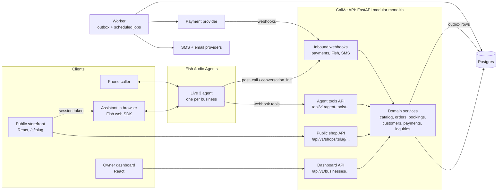
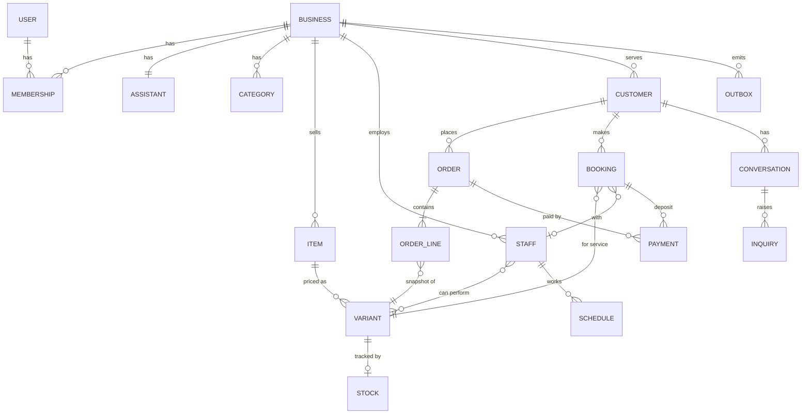
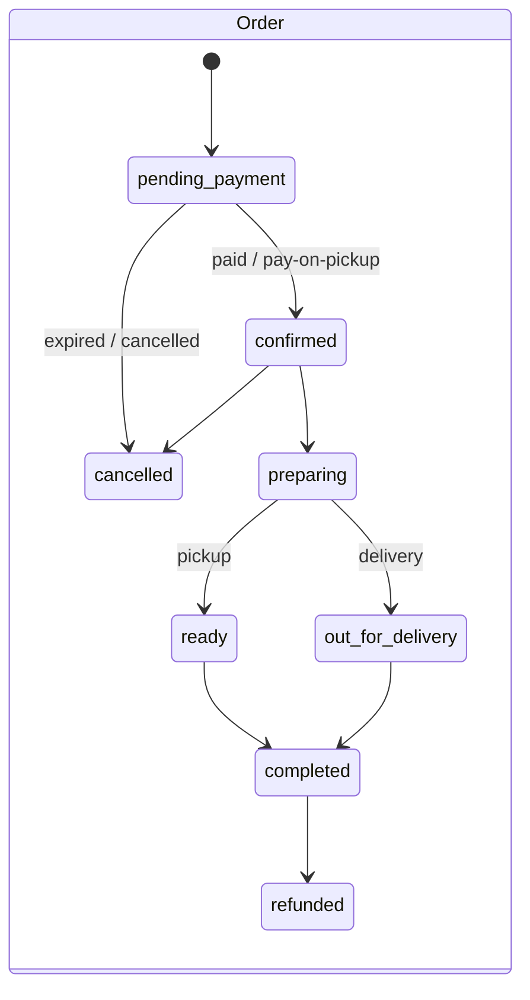
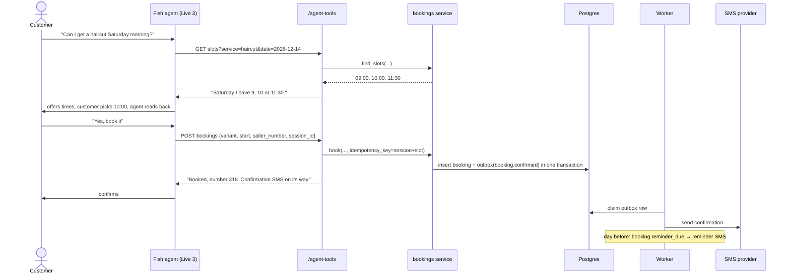

# CalMe shop platform: architecture

Status: proposal, 2026-11-13. Builds on the current backend (FastAPI, async SQLAlchemy,
Postgres, Alembic, the repository and provider patterns) and the Fish Audio agent
integration already in place.

## 1. What we are building

Every business gets a **digital shop**. Customers can use it to:

- browse what the business sells, whether **products** (things you ship or collect) or
  **services** (things you book a time for),
- ask questions,
- place orders and book appointments,
- get updates by SMS and email.

They can do all of this by tapping through the shop, or by talking to the business's
**assistant**, which can do everything the shop can.

The owner runs it like a normal online store: a catalog, stock, opening hours, staff
calendars, an order and booking inbox, customers, and notifications.

The one rule that shapes everything else:

> The shop and the assistant are two front doors to the **same** backend operations.
> The assistant never has its own logic for prices, stock or availability. It calls
> the same services the storefront calls.

## 2. System overview



Key choices:

| Choice | Decision | Why |
|---|---|---|
| Shape | **Modular monolith** in the existing FastAPI app | One deploy, one database, shared transactions (an order and its stock reservation commit together). Split later only if a module needs to scale on its own. |
| Tenancy | **Shared database, `business_id` on every tenant table** | Simple, cheap, fine for many small businesses. Postgres row-level security can be added later as a second guard. |
| Background work | **Postgres outbox + a worker process** (`python -m app.worker`) | No Redis or queue service needed yet. `SELECT … FOR UPDATE SKIP LOCKED` lets several workers share the queue safely. |
| Assistant actions | **Fish webhook tools** calling `/api/v1/agent-tools/*` | This is how Fish agents act. Responses come back as the words the agent speaks. |
| Money | Integers in minor units plus an ISO currency code | No float rounding errors. |
| Time | UTC in the database; each business has an IANA timezone | Slots, opening hours and reminders are computed in the business's local time. |

## 3. Backend layout

Each module keeps the pattern the code already uses: schemas, then a repository, then a
service, then routes. Providers sit behind interfaces in `app/providers/base.py`.

```
app/
  core/            config, errors, logging, auth (new), tenancy (new)
  db/              engine, Base, models split per module
  providers/       fish_agent, fish_audio, payments/*, sms/*, email/*
  modules/
    accounts/      users, sessions, business membership + roles
    businesses/    business profile, shop settings, hours, policies
    catalog/       categories, items (product | service), variants, images
    inventory/     stock levels, reservations
    scheduling/    staff/resources, schedules, time off, slot finder
    customers/     customer records, consent
    orders/        cart → order, fulfilment, order numbers
    bookings/      appointments
    payments/      payment intents, provider webhooks, refunds
    inquiries/     questions the assistant couldn't answer, messages for the owner
    conversations/ assistant sessions, transcripts, summaries (from post_call)
    notifications/ templates, outbox, delivery status
    assistant/     today's agent_service + fish_agent_sync, plus tool endpoints
  api/v1/          routers wired to modules (dashboard, public, agent_tools, webhooks)
  worker.py        outbox dispatcher + scheduled jobs
```

The existing `Agent` becomes the **assistant** of a `Business` (`agents.business_id`).
The free-text `business_description` stays for policies and tone. Facts that change
(prices, stock, hours, free slots) move to structured tables that the assistant
**looks up through tools** instead of having them pasted into its prompt. Then a price
change takes effect straight away, without republishing the Fish agent.

## 4. Data model



### Core tables (abridged)

**businesses**: `id, name, slug (unique, shop URL), kind (products|services|both),
timezone, currency, country, phone, email, address, logo_url, policies_text,
is_published, created_at`

**users / memberships**: `memberships(business_id, user_id, role: owner|staff)`.
Every dashboard request runs inside one business. See Security (section 9).

**business_hours**: `business_id, weekday, opens_at, closes_at` plus
`closures(business_id, starts_at, ends_at, reason)` for holidays.

**categories**: `id, business_id, name, position`

**items**: one table for everything sold.
`id, business_id, category_id, kind (product|service), name, description,
images[], is_active, position`

**variants**: what is actually priced and chosen. Sizes and colours for products,
lengths or tiers for services. Every item has at least one.
`id, item_id, name, price_minor, sku,`
product-only: `track_stock, weight_g, fulfilment (pickup|delivery|both)`,
service-only: `duration_min, buffer_min, capacity (default 1), deposit_minor`

> Why one items table with a `kind` column, not separate product and service tables?
> Both share browsing, search, categories, images and the assistant's
> `search_catalog` tool. The parts that differ (stock vs. time) live on variants and in
> their own modules. A salon that also sells shampoo needs no special case.

**stock**: `variant_id, on_hand, reserved` and
`stock_reservations(id, variant_id, order_id, qty, expires_at)`.

**staff**: `id, business_id, name, is_active`, with `staff_services(staff_id,
variant_id)`, `staff_schedules(staff_id, weekday, start, end)` and
`staff_time_off(staff_id, starts_at, ends_at)`. A business with no staff gets one
default "the business" resource, so the slot finder always has something to book.

**customers**: `id, business_id, name, phone_e164, email, sms_opt_in, email_opt_in,
notes, created_at`, unique on `(business_id, phone_e164)`. Phone is the main identity,
because callers have one and most customers prefer SMS.

**orders**: `id, business_id, number (per-business sequence, e.g. 1042),
customer_id, channel (shop|assistant_web|assistant_phone|dashboard), status,
fulfilment (pickup|delivery), delivery_address, notes, subtotal_minor, delivery_minor,
total_minor, currency, public_token, idempotency_key, created_at`

**order_lines**: `order_id, variant_id, item_name, variant_name, unit_price_minor,
qty`. These are snapshots, so later price changes never rewrite past orders.

**bookings**: `id, business_id, number, customer_id, variant_id, staff_id,
starts_at, ends_at, status, channel, notes, public_token, idempotency_key`
with a Postgres **exclusion constraint** so one staff member can't be double-booked:

```sql
CREATE EXTENSION IF NOT EXISTS btree_gist;
ALTER TABLE bookings ADD CONSTRAINT no_overlap
  EXCLUDE USING gist (staff_id WITH =, tstzrange(starts_at, ends_at) WITH &&)
  WHERE (status IN ('pending_payment', 'confirmed'));
```

**payments**: `id, business_id, order_id | booking_id, provider, provider_ref,
amount_minor, currency, status (pending|succeeded|failed|refunded), raw jsonb`

**conversations**: `id, business_id, fish_session_id, channel, customer_id,
caller_number, started_at, duration_s, summary, transcript jsonb, analysis jsonb`.
Filled in by Fish's `call.analyzed` webhook.

**inquiries**: `id, business_id, conversation_id, customer_id, question,
status (open|answered|closed), answer`. These are the "take a message" cases the
owner follows up.

**outbox**: `id, business_id, event, payload jsonb, status, attempts,
next_attempt_at, created_at`

**notifications**: `id, business_id, customer_id, channel (sms|email),
template, to, body, status, provider_ref, error`

### Lifecycles



Bookings: `pending_payment` (only if a deposit is due) → `confirmed` →
`completed` / `no_show` / `cancelled`. Every status change writes an outbox event,
for example `order.confirmed` or `booking.reminder_due`. Notifications and any later
integrations react to those events.

## 5. The core operations

These services hold the business rules. The dashboard, the public shop and the
assistant all call them.

| Service call | What it guarantees |
|---|---|
| `catalog.search(business, query)` | Only active items. Prices in the business currency. Includes "in stock" and "next free slot" hints. |
| `scheduling.find_slots(variant, date_range, staff?)` | Business hours ∩ staff schedule − time off − existing bookings − buffers, stepped by duration, in the business timezone. |
| `orders.place(cart, customer, fulfilment, idempotency_key)` | In one transaction: re-prices from the catalog, reserves stock (`SELECT … FOR UPDATE`), creates the order and lines, writes `order.created`. The same idempotency key returns the same order, which protects against agent or browser retries. |
| `bookings.book(variant, start, customer, staff?, idempotency_key)` | Re-checks the slot and inserts the booking. The exclusion constraint is the final guard against double booking. A deposit puts it in `pending_payment`. |
| `payments.start(order or booking)` | Creates a payment with the provider and returns a pay link (or triggers an M-Pesa prompt). Confirmation **only** comes from the provider's signed webhook. |
| `inquiries.open(question, customer)` | Saves it and notifies the owner. |

Unpaid reservations and holds expire. A scheduled job releases stock and cancels
`pending_payment` orders and bookings after a set time (for example 30 minutes).

## 6. Public storefront

- **URL**: `calme.app/s/{slug}` to start; custom domains later.
- **Public API** (`/api/v1/shops/{slug}/…`), with no login:
  - `GET /` (profile, hours, policies),
  - `GET /catalog`,
  - `GET /items/{id}`,
  - `GET /slots?variant=&from=&to=`,
  - `POST /orders`,
  - `POST /bookings`,
  - `GET /orders/{public_token}`.
  - Plus `POST /assistant/session`, the same Fish session flow as today's "Try it"
    but open to the public and rate-limited.
- **Cart** lives in the browser until checkout. The server re-prices everything.
- **Customers don't need accounts.** Checkout asks for name and phone (and optionally
  email). Order and booking pages are reached through a `public_token` link sent by
  SMS or email. "My orders" can later work through a one-time code sent by SMS.
- **Frontend**: a second route group in the same Vite app (`/s/:slug`) at first. It
  can be split into its own app if it needs separate hosting or SEO rendering.

## 7. The assistant as a shop clerk

### How Fish reaches our backend

Fish agents act through **webhook tools**: Fish sends HTTP requests to URLs we
register. The response body is what the agent reads and then speaks. Tool requests
are **not signed** by Fish. The only authentication is a header we configure, and
`authorization_bearer` headers are write-only.

**Decision: create one set of tools per business**, each carrying that business's
own secret as a bearer token, and attach them only to that business's agent. The
token identifies the business and authenticates the call in one step, and one
business's agent can never reach another business's data. `fish_agent_sync` already
creates and publishes the agent. It will also create, update and attach the tools,
and rotate the token when needed.

The tools:

| Tool | Method / URL | Mode | Used for |
|---|---|---|---|
| `search_catalog` | GET `/agent-tools/catalog?q={{query}}` | blocking | "Do you have…", "How much is…" |
| `check_availability` | GET `/agent-tools/slots?service={{service}}&date={{date}}` | blocking | "Can I come Saturday?" |
| `book_appointment` | POST `/agent-tools/bookings` | blocking | Books a slot the customer agreed to |
| `place_order` | POST `/agent-tools/orders` | blocking | Pickup or delivery order, sends a pay link |
| `order_status` | GET `/agent-tools/orders/{{order_number}}` | blocking | "Where's my order?" |
| `take_message` | POST `/agent-tools/inquiries` | fire_and_forget | Anything it can't answer |

Every request also carries `{{system.session_id}}`, `{{system.channel}}` and
`{{system.caller_number}}`. That ties the action to the conversation, and on phone
calls the caller's number becomes the customer's phone without asking for it.
Writing tools pass `{{system.session_id}}` plus the item and slot as the idempotency
key, so a retry never creates a second order.

Responses are short and meant to be spoken, for example
`"Booked: haircut with Wanjiru, Saturday 14 December at 10:00. Booking number 318. A
confirmation SMS is on its way."`. They are never raw JSON dumps.

### Rules the assistant follows

These go in the system prompt that `prompt_builder` generates.

- Look up prices, stock and availability with tools. Never state them from memory.
- Before booking or ordering, read the details back and get a clear "yes".
- **Never take payment details by voice.** Paying always happens through a link or
  M-Pesa prompt sent to the customer's phone.
- If unsure, use `take_message`.

### Phone calls (when calls come back)

Fish's `conversation_init` webhook sends us the caller's number before the call
connects. We reply with `dynamic_variables` such as the customer's name and open
orders, so the agent can greet returning customers by name. It must answer within 8
seconds; if it fails, the call still connects with the defaults.

### After every conversation

Fish's `post_call` webhook sends `call.analyzed` with the transcript, a summary and
analysis. It is signed with HMAC-SHA256 in `X-Fish-Webhook-Signature`, delivered at
least once and retried for about 18 hours. We verify the signature, dedupe on
`event_id`, and store the result as a `conversation`. The owner sees it in the inbox
alongside the orders and bookings it produced.

### Example: voice booking



## 8. Notifications, payments and other providers

All of these sit behind interfaces in `app/providers/base.py`, like TTS and telephony
do today:

- `PaymentProvider`: `create_payment(...) -> PaymentStart`,
  `parse_webhook(request) -> PaymentEvent`, `refund(...)`.
- `SmsProvider.send(to, body)` and `EmailProvider.send(to, subject, html, text)`.

Recommended first providers. This assumes Kenya-first (the app's examples use
Nairobi), so change these if that's wrong:

| Need | First provider | Why |
|---|---|---|
| Mobile money | **M-Pesa Daraja STK push** | How most customers pay. The prompt appears on their phone, so it works mid-conversation. |
| Cards | **Paystack** (or Stripe outside Africa) | Hosted checkout links; we never touch card numbers. |
| SMS | **Africa's Talking** (or the existing Twilio account) | Local delivery rates and sender IDs. |
| Email | **Resend** or Postmark | Simple API, good deliverability. |

Notification flow: service writes an outbox event → worker matches the event to
templates (`order.confirmed` → SMS + email) → sends only if the customer has opted
in to that channel → records the delivery status. Templates are per business with
sensible defaults, and support `{{customer_name}}`, `{{order_number}}`,
`{{pay_link}}` and so on.

Minimum events: `order.created` (with pay link), `order.confirmed`,
`order.ready`, `order.out_for_delivery`, `booking.confirmed`,
`booking.reminder_due` (24 h before), `booking.cancelled`, `inquiry.opened` (to the
owner).

## 9. Security and tenancy

- **Owner auth**: email + password (argon2) or a magic link, with sessions in an
  httpOnly cookie. The dashboard API resolves `business_id` from the URL, checks the
  user's membership, and passes a `TenantContext` into every repository. A repository
  method can't run without one.
- **Today the API has no auth at all.** It must come before any real business data or
  the public shop goes live.
- **Agent tools**: the per-business bearer token (see 7). It is stored hashed, and
  every tool route runs in that business's tenant context.
- **Inbound webhooks**: verify Fish's HMAC signature and each payment provider's
  signature. Dedupe on event IDs.
- **Public API**: rate limits per IP and per slug (stricter on `POST
  /assistant/session`, which costs money per minute). Validate phone numbers as
  E.164.
- **Personal data**: phone numbers, addresses and transcripts. Keep transcripts only
  as long as useful (for example 90 days) and turn off Fish recordings where they
  aren't needed.

## 10. Dashboard, as it grows

Today: **Home** and **Assistants**. Planned navigation, added as each phase lands:

Home · **Shop** (catalog, hours, staff) · **Orders** · **Bookings** ·
**Customers** · **Inbox** (inquiries + conversations) · Assistant · Settings
(payments, notifications, team).

A products-only shop never sees Bookings or Staff, and a services-only shop never sees
stock or delivery. `businesses.kind` decides what's shown.

## 11. Delivery plan

| Phase | Scope | Done when |
|---|---|---|
| 0. Foundations | Auth, `businesses` + memberships, `agents.business_id`, tenant context, slug, outbox + worker skeleton | An owner signs in and only sees their own business |
| 1. Catalog + storefront | Categories, items, variants, images, public shop browse pages, `search_catalog` tool | A customer browses the shop and the assistant answers price questions from live data |
| 2. Bookings | Staff, schedules, slot finder, booking checkout, `check_availability` + `book_appointment` tools, confirmation + reminder SMS/email | A service business takes bookings by tapping or by voice, with no double bookings |
| 3. Orders + payments | Stock, cart, checkout, M-Pesa + card links, `place_order` + `order_status` tools, order status notifications | A product business takes paid pickup or delivery orders |
| 4. Inbox | `post_call` webhook → conversations, `take_message` → inquiries, owner replies | The owner sees every conversation and follows up on open questions |
| 5. Calls again | Phone numbers, `conversation_init` greeting returning customers | Customers can call the shop |

Phases 1–3 each build a vertical slice (data model, then service, then dashboard, then
storefront, then assistant tool) instead of all the tables first. That way something
customers can use ships at the end of every phase.

## 12. Open questions

1. **Region and payments.** Is Kenya and M-Pesa the first market? That decides the
   payment and SMS providers.
2. **Delivery.** Does the business deliver with flat or zone-based fees, or do we
   need a courier integration later?
3. **Catalog size.** Will some shops have thousands of items? If so, add Postgres
   full-text search (or `pg_trgm`) to `search_catalog` early.
4. **Fish gaps to test.** Not documented: whether tool calls are retried (we assume
   they might be, hence idempotency keys), what tools are sent when there is no body
   template (we will always set one), and the size limit on tool responses (keep them
   short).
